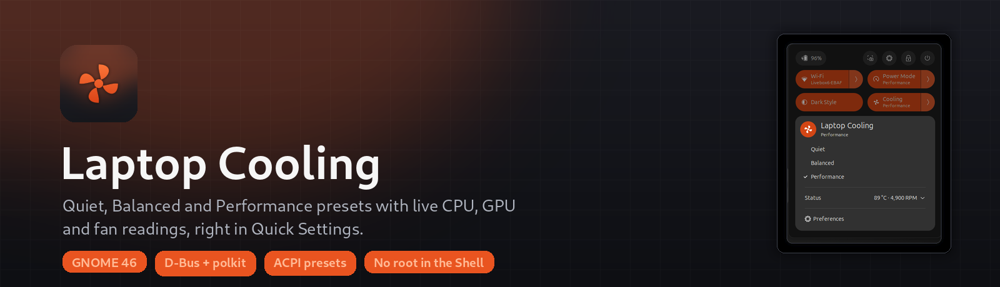
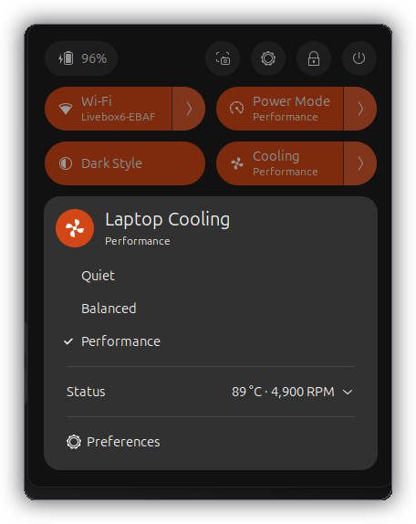
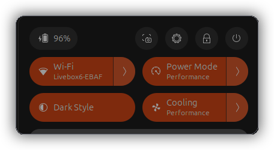
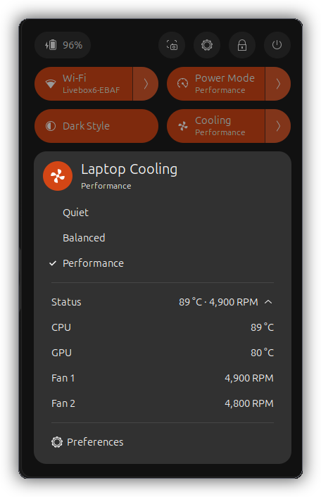
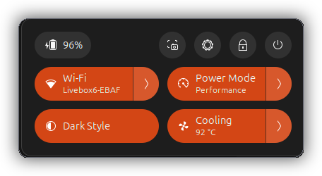
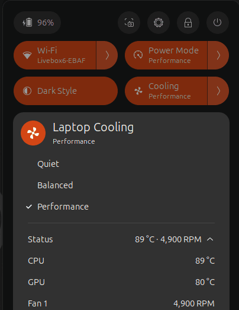
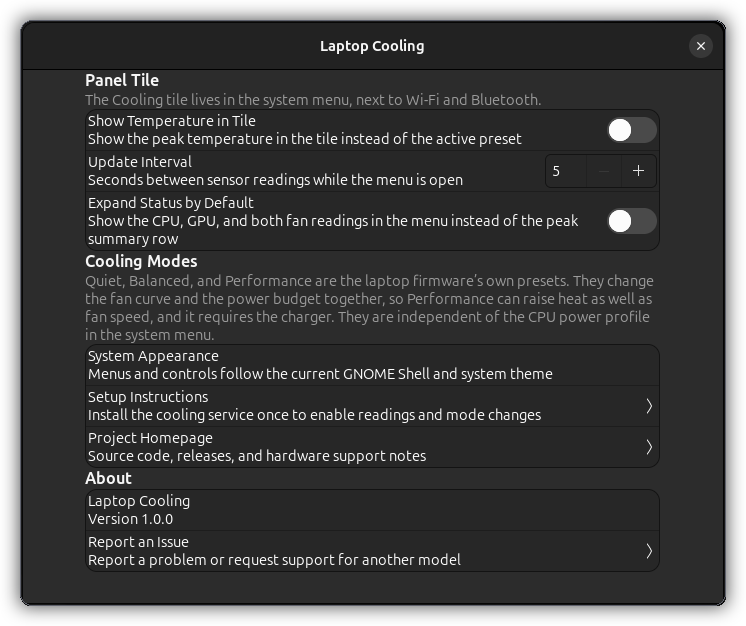
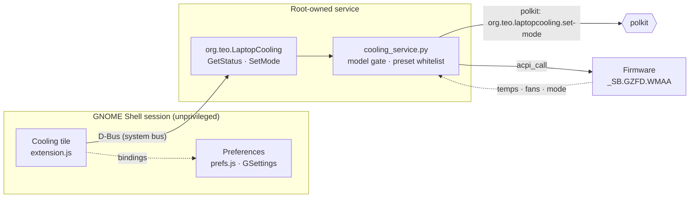
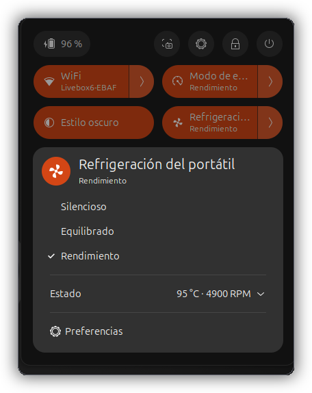

<div align="center">



# Laptop Cooling

**Live CPU and GPU temperatures, both fan speeds, and the laptop's own
Quiet / Balanced / Performance presets, right in the Quick Settings menu.**

[](https://extensions.gnome.org/extension/11287/laptop-cooling/)
[](LICENSE)
[](docs/hardware-support.md)
[](#requirements)
[](#security-and-privacy)



<sub>Every screenshot in this README was captured from the packaged extension
running in a throwaway GNOME Shell session; see [Validation](#validation).</sub>

</div>

---

## Table of contents

- [Why](#why)
- [Features](#features)
- [Requirements](#requirements)
- [Installation](#installation)
- [Usage](#usage)
- [How it works](#how-it-works)
- [Security and privacy](#security-and-privacy)
- [Validation](#validation)
- [Localization](#localization)
- [Troubleshooting](#troubleshooting)
- [Development](#development)
- [Roadmap](#roadmap)
- [Contributing](#contributing)
- [License and credits](#license-and-credits)

## Why

Laptops that expose their cooling controls through ACPI have no desktop
integration: the temperatures and fan speeds the firmware already knows about
are invisible unless you reboot into the firmware setup utility, and the
presets most owners actually use, *Quiet* on the couch and *Performance* when
plugged in, are locked behind the vendor's own Windows software.

This extension puts that data where GNOME 46 already shows device state, the
**Quick Settings** menu. There is no extra top-bar button, no panel of its
own, and no second settings application: the tile sits next to Wi-Fi and
Bluetooth, follows the system theme, and expands in place.

Firmware writes are deliberately boring: a small root-owned service evaluates
two documented ACPI methods behind polkit and answers with a status string.
The extension itself never touches `/proc/acpi/call`, never runs as root, and
stays usable, with a plain "service unavailable" tile, on machines where the
service is not installed.

## Features

### A Cooling tile that belongs in the system menu



The tile is a standard `QuickSettings` item: it appears with the other system
tiles, supports keyboard navigation, and collapses when you click anywhere
else. Optionally it prints the peak of the two temperatures in its subtitle
(*CPU and GPU shown as the higher value*) so the number is visible without
opening anything.

The tile is theme-driven, so it looks native under the default GNOME theme,
Yaru, and any theme that respects the system color scheme, light or dark.

<br clear="right">

### Live readings, summarised first



Opening the tile shows the **peak summary row** first: the hottest
temperature and the fastest fan, exactly what you want at a glance:

```
Status                                   95 °C · 4,900 RPM   ⌄
```

Clicking the row expands it **in place** (no second dialog, the menu stays
open) into the full picture:

```
Status                                             ⌃
  CPU            95 °C
  GPU            94 °C
  Fan 1       4,900 RPM
  Fan 2       4,800 RPM
```

Readings refresh only while the menu is open, at an interval you choose
(5-30 seconds, 5 by default), so an idle desktop costs nothing. A
**Preferences → Expand Status by Default** switch flips the default so the
detailed rows are what you see first.

<br clear="right">

### The laptop's own presets, not a software fan curve



*Quiet*, *Balanced* and *Performance* are the firmware's presets, written
through the same ACPI method the vendor tool uses. That means the fan curve,
the power budget and the thermal behaviour change together, exactly as the
machine was designed to behave: no userspace fan control, no PWM poking, no
kernel patches.

The current preset is checked in the menu; switching shows a spinner in the
row, and the answer coming back from the service is what the menu displays.
If the firmware refuses, for example *Performance* while running on battery,
the extension says so instead of pretending the mode changed.

<br clear="right">

### Readings that keep moving



While the menu is open, the readings refresh on their own timer. The animation
is a real capture, frames every two seconds, in which the preset is switched
from **Quiet** to **Performance** through the service, and the rows (and the
checkmark) follow what the firmware reports.

<br clear="right">

### Preferences that stay out of the way



Three settings, no configuration files:

| Setting | Default | What it does |
| --- | --- | --- |
| Show Temperature in Tile | off | Print the peak temperature in the tile subtitle |
| Update Interval | 5 s | How often readings are refreshed while the menu is open (5-30 s) |
| Expand Status by Default | off | Open the menu with all four readings instead of the peak row |

The page also links to the setup instructions, the project homepage, the
issue tracker, and the installed version, so the whole extension is one click
away from its own documentation.

<br clear="right">

### Behaviour that survives a desktop session

- **No private APIs.** The extension uses `QuickSettings`/`PopupMenu` public
  classes, `connectObject()`/`disconnectObject()` for every signal, and
  destroys every actor it creates. Nothing is left behind when the extension
  is disabled or the shell reloads.
- **GNOME Shell 46 only.** The bundled `shell-version` is deliberate; the
  extension is tested against 46 and does not claim compatibility it has not
  been verified for.
- **Translatable.** Every string goes through gettext; English and Spanish
  ship in the bundle today.

## Requirements

| | |
| --- | --- |
| **Desktop** | GNOME Shell **46** (tested on Ubuntu 24.04, Wayland and X11) |
| **Hardware** | Lenovo IdeaPad Gaming 3 15IMH05, model **81Y4**, BIOS **EGCN41WW**; see [hardware support](docs/hardware-support.md) |
| **Service** | `acpi_call` kernel module (distribution package, e.g. `acpi-call-dkms`), Python 3 with PyGObject, polkit |
| **Privileges** | Root **once**, to install the service. The desktop session never runs as root. |

On any other model the extension still loads and tells you that the hardware
is not supported instead of guessing at firmware calls. Extending support is a
documented, testable process: [docs/hardware-support.md](docs/hardware-support.md).

## Installation

### 1. Install the cooling service (once, as root)

The extension is a front-end; the privileged half lives in
`service/cooling_service.py`.

```bash
git clone https://github.com/joseteo/laptop-cooling.git
cd laptop-cooling
sudo bash scripts/install-service.sh
```

The installer verifies the exact model and BIOS, loads `acpi_call`, installs
the Python service, its D-Bus policy and the polkit action, then enables the
systemd unit and prints the current status. **It does not change the cooling
mode.** The script is safe to re-run; see
[scripts/uninstall-service.sh](scripts/uninstall-service.sh) for the reverse.

### 2. Install the extension

The **extensions.gnome.org** listing at
`https://extensions.gnome.org/extension/11287/laptop-cooling/` is in review. It
becomes installable once it passes; while no version is approved the page is
served only to the owner and to reviewers. Install from a checkout meanwhile:

```bash
bash scripts/install-extension.sh      # builds dist/…zip and installs it
```

or manually, with any build of the bundle:

```bash
gnome-extensions install --force dist/laptop-cooling@joseteo.github.io.shell-extension.zip
```

Then sign out and back in (Wayland), or `Alt+F2`, `r`, `Enter` on X11, and
enable **Laptop Cooling** in the Extensions application. On a system where the
service is missing, the tile opens with a *Cooling service unavailable* panel
that links straight to the setup instructions, and everything else in the
shell keeps working.

### Uninstall

```bash
gnome-extensions uninstall laptop-cooling@joseteo.github.io
sudo bash scripts/uninstall-service.sh     # optional: removes the service
```

## Usage

1. Click the system menu in the top-right corner.
2. Open the **Cooling** tile.
3. Read the peak row, or click **Status** to expand all four readings.
4. Pick **Quiet**, **Balanced** or **Performance** to switch presets.
   *Performance* needs the charger connected: the firmware refuses it on
   battery, and the menu tells you why.

Keyboard: the tile and its menu are ordinary `St` widgets, so arrows, `Tab`
and `Space`/`Return` work as expected while the menu has focus.

## How it works



- **Reads** are a single `GetStatus` call that returns a JSON status string:
  CPU and GPU temperature, both fan speeds, the active preset, and whether the
  firmware reports the machine as supported.
- **Writes** are a single `SetMode(mode)` call with `quiet`, `balanced` or
  `performance`. Any other string is rejected before the firmware is touched.
- The service holds an exclusive `flock` on
  `/run/lock/ideapad-fan-getters.lock` for every ACPI transaction, so the
  extension, `sensors`, and any other tool reading the same embedded
  controller serialise instead of interleaving queries.
- The extension polls only while its menu is open and stops the timer when the
  menu closes or the extension is disabled.

The extension ships as one zip: `extension.js`, `prefs.js`, one GSettings
schema, the symbolic icon, the compiled translations, and this README. The
complete layout and the reasoning behind the split are in
[docs/architecture.md](docs/architecture.md).

## Security and privacy

| Property | How |
| --- | --- |
| No root in the desktop session | Sensors and presets live in a systemd service; the extension is a D-Bus client. |
| Authorised writes only | `SetMode` is guarded by the polkit action `org.teo.laptopcooling.set-mode`; unprivileged callers get a standard authentication dialog. |
| Small attack surface | Two D-Bus methods, one documented ACPI namespace, no shell, no network, no files written outside `/run/lock`. |
| No guessing at hardware | The service refuses to start on any model/BIOS pair other than 81Y4/EGCN41WW, so an unknown machine is never poked with vendor calls. |
| Safe ACPI access | The lock file must be a root-owned regular file without group/other write access, `O_NOFOLLOW` on open, `flock` around every transaction. |
| No telemetry | The extension makes no network requests of any kind. Readings, settings and errors stay on the machine. |
| Unprivileged defaults | Installing the service does not change the cooling mode; the first mode change happens when a user asks for one. |

Found a security issue? Please use the private process described in
[SECURITY.md](SECURITY.md) rather than a public issue.

## Validation

The screenshots in this README are not mock-ups. They are produced by
`qa/run.sh`, which boots an **isolated, headless GNOME Shell 46** with
throwaway `XDG_*` directories, its own session bus and its own Wayland socket,
installs the **exact zip that is distributed**, and drives it with a QA-only
companion extension. The live desktop is never touched.

```bash
QA_SCENARIO=qa/scenarios/verify-cleanup.json bash qa/run.sh   # lifecycle and signal checks
QA_SCENARIO=qa/scenarios/capture-all.json bash qa/run.sh      # 22 frames + session log
bash scripts/run-tests.sh                                     # schemas, translations, service tests
```

What the harness checks, beyond producing pictures:

- **Lifecycle cleanup**: the number of shell actors before enabling, after
  disabling, and after re-enabling is recorded and compared
  (`229 → 242 → 229 → 242` on the reference machine: no growth, no leaks), with
  `destroy` watchers on the tile, the menu and the panel indicator.
- **Signal hygiene**: a probe enables and disables the extension repeatedly
  and asserts that every `connectObject()` connection is gone after
  `disable()` while unrelated connections keep firing.
- **Interaction**: an automated click on the **Status** row must flip
  `show-status-details` *and* leave the menu open (which a `PopupMenuItem`
  would not); the capture scenarios then switch presets through the service and
  open the real `prefs.js` in the session.
- **Real firmware**: mode changes go through the installed service, so the
  captured frames show the machine's true temperatures, fan speeds and preset.

The QA tooling (scenarios, the standalone preferences runner, and how the
harness survives GNOME Shell's extension *rebasing*) is documented in
[qa/README.md](qa/README.md).

## Localization



Strings are extracted with `po/update-pot.sh` and shipped as compiled
catalogues inside the bundle. The menu on the right is the same QA session
started with `QA_LOCALE=es_ES.UTF-8`; the catalogue that ships in the bundle
is the one being rendered.

| Language | Status |
| --- | --- |
| English | source |
| Spanish (`es`) | complete (40/40 strings) |

Add a language by copying `po/laptop-cooling.pot` to `po/<lang>.po`, filling in
the entries, and running `scripts/build-extension.sh`: the build compiles
every `po/*.po` it finds and fails on a malformed catalogue. Translation
screenshots can be produced with
`QA_SCENARIO=qa/scenarios/capture-menus.json QA_LOCALE=<locale> bash qa/run.sh`.

<br clear="right">

## Troubleshooting

<details>
<summary><b>The tile says "Cooling service unavailable"</b></summary>

The privileged service is not installed or not running.

```bash
systemctl status laptop-cooling.service
gdbus call --system --dest org.teo.LaptopCooling \
    --object-path /org/teo/LaptopCooling \
    --method org.teo.LaptopCooling.GetStatus
```

If the call fails, re-run `sudo bash scripts/install-service.sh`. The
installer checks `acpi_call` and the model/BIOS pair for you.
</details>

<details>
<summary><b>"Unsupported" on a supported-looking laptop</b></summary>

Support is gated on the exact DMI model and BIOS version, not the marketing
name: IdeaPad Gaming 3 units ship with several firmware revisions. Check:

```bash
cat /sys/class/dmi/id/product_name /sys/class/dmi/id/bios_version
# 81Y4
# EGCN41WW
```

A different BIOS needs verification before it can be added; see
[docs/hardware-support.md](docs/hardware-support.md).
</details>

<details>
<summary><b>Performance cannot be selected while on battery</b></summary>

That is the firmware's rule, not the extension's: the vendor preset that
raises the power budget requires the charger. Connect it and pick
*Performance* again. *Quiet* and *Balanced* work on battery.
</details>

<details>
<summary><b>The menu shows "Changing cooling mode…" and then an error</b></summary>

The service answered that the mode was not changed, usually because the
firmware rejected the preset for the current power source. The menu restores
the previous state; nothing is left showing a mode the machine is not in.
`journalctl -u laptop-cooling.service -n 50` has the exact answer.
</details>

<details>
<summary><b>Readings do not update</b></summary>

Values refresh on a timer that only runs while the menu is open, at the
interval set in Preferences (default 5 s). If they never appear, the tile's
status line shows the underlying D-Bus error; the same error is in
`journalctl -f -o cat /usr/bin/gnome-shell`.
</details>

## Development

```bash
bash scripts/build-extension.sh   # dist/<uuid>.shell-extension.zip
bash scripts/run-tests.sh         # schemas, translations, service and D-Bus tests
sudo bash scripts/install-service.sh
bash scripts/install-extension.sh
```

| Path | Contents |
| --- | --- |
| `extension/` | The shipped extension (Shell 46 code, schema, icon, its own README) |
| `service/` | The root-owned Python service, D-Bus policy, polkit action, unit tests |
| `qa/` | Isolated headless GNOME Shell harness, scenarios and the preferences runner |
| `scripts/` | Build, install, test and artwork tooling |
| `docs/` | Architecture, hardware support, publishing notes and generated artwork |

Requirements: `glib-compile-schemas`, `msgfmt` and Python 3 for the unit and
D-Bus tests; a full GNOME Shell 46 session additionally for the QA scenarios.
The artwork step needs `python3-gi` with GdkPixbuf, Pillow, and any font with
Cantarell metrics installed. Everything except the QA session runs on any
developer machine.

## Roadmap

- [x] Quick Settings tile with peak-temperature subtitle
- [x] In-place expandable status row (CPU, GPU, Fan 1, Fan 2)
- [x] Firmware presets through a polkit-guarded service
- [x] English and Spanish catalogues
- [x] Automated lifecycle/leak verification
- [ ] Support matrix for further IdeaPad Gaming revisions
      ([open an issue](https://github.com/joseteo/laptop-cooling/issues) with
      `cat /sys/class/dmi/id/product_name /sys/class/dmi/id/bios_version`)
- [ ] Optional history graph for the last few minutes

## Contributing

Issues and pull requests are welcome; start with
[CONTRIBUTING.md](CONTRIBUTING.md), which describes the constraints the code
must respect (no private shell APIs, connections with an owner, no root code
in the session) and the checks a pull request has to pass.

## License and credits

GPL-2.0-or-later; see [LICENSE](LICENSE).

Built by [joseteo](https://github.com/joseteo). Thanks to the GNOME Shell
extension review process for the review notes that shaped the lifecycle code,
and to the `acpi_call` and `ideapad-fan` communities for documenting the
firmware interface this service speaks.
